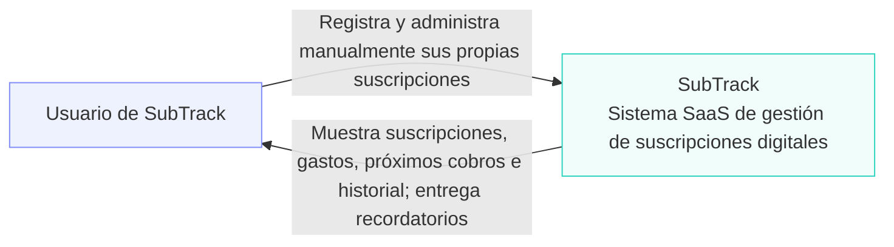

## Diagrama 1 — Contexto

Descripción
Se mantiene únicamente al Usuario de SubTrack y al sistema SubTrack, sin tecnologías ni sistemas externos.
- Usuario de SubTrack: ingresa y administra manualmente sus propias suscripciones.
- SubTrack: permite consultar suscripciones, gastos, próximos cobros e historial y recibir recordatorios.
- Relaciones: representan las acciones del usuario y la información que devuelve el sistema; no establecen un canal específico de notificación.
