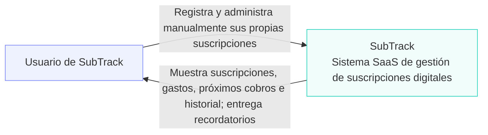
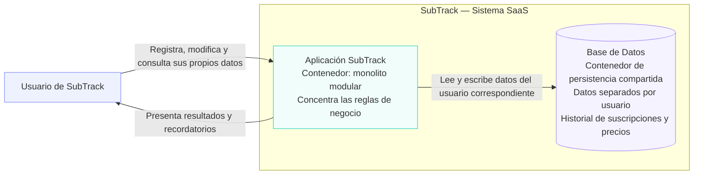

## Diagrama 1 — Contexto

Descripción
Se mantiene únicamente al Usuario de SubTrack y al sistema SubTrack, sin tecnologías ni sistemas externos.
- Usuario de SubTrack: ingresa y administra manualmente sus propias suscripciones.
- SubTrack: permite consultar suscripciones, gastos, próximos cobros e historial y recibir recordatorios.
- Relaciones: representan las acciones del usuario y la información que devuelve el sistema; no establecen un canal específico de notificación.

## Diagrama 2 — Contenedores

Descripción
Diagrama 2 — Contenedores. SubTrack contiene exactamente dos contenedores: la Aplicación SubTrack y la Base de Datos. Los módulos internos no aparecen como aplicaciones desplegables independientes.
- Usuario: se comunica con la aplicación, no directamente con la base de datos.
- Aplicación SubTrack: es una única unidad desplegable que contiene todos los módulos y las reglas de negocio.
- Base de Datos: conserva la información de los usuarios en un modelo compartido, con separación lógica por usuario, incluidos los historiales de suscripciones y precios.
- Límite SubTrack: agrupa los dos contenedores del sistema.
- Comunicación: el usuario opera mediante la aplicación y esta accede a los datos correspondientes. No se especifican protocolos ni tecnologías.
