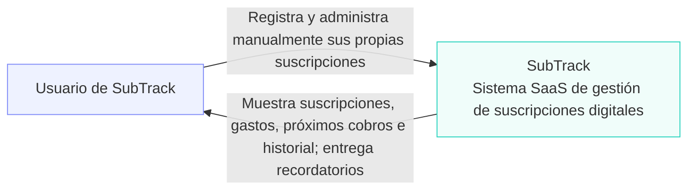
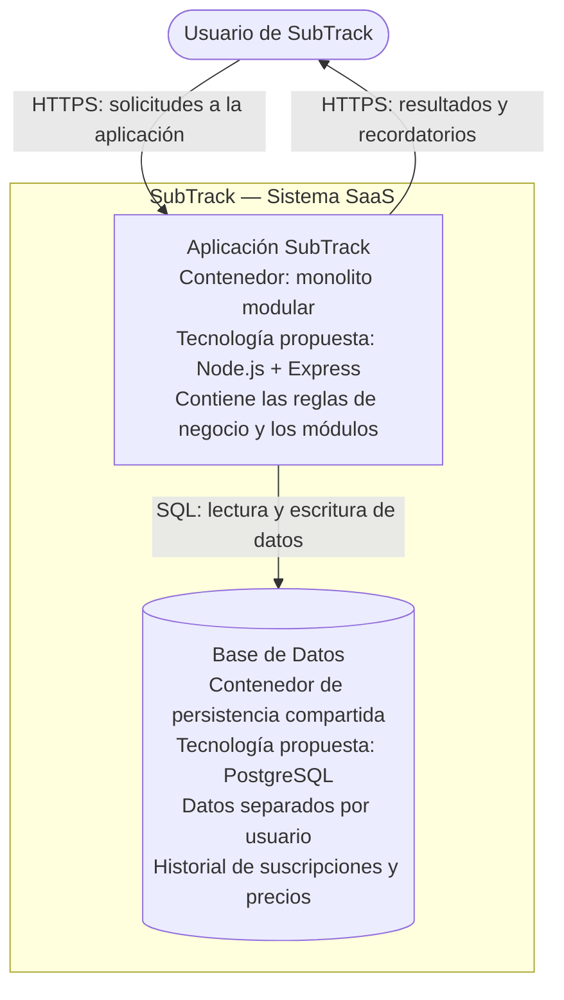
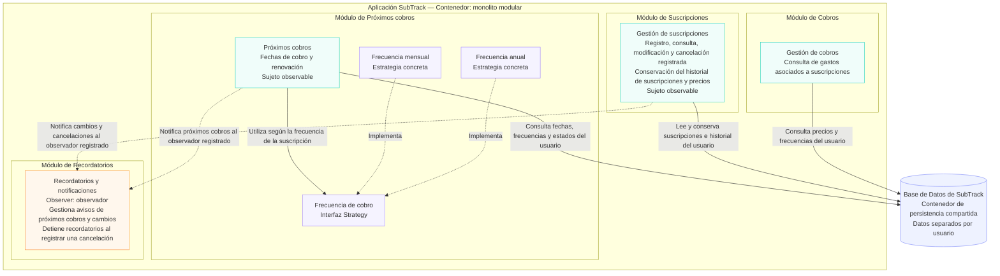
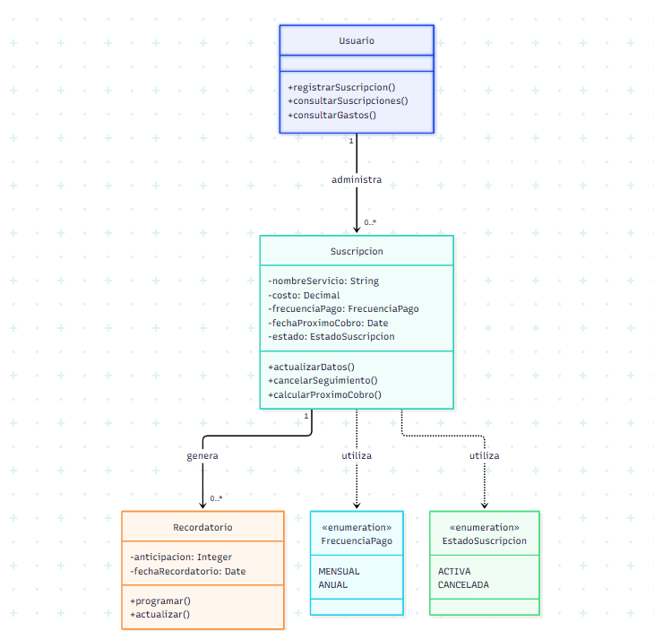

## Diagrama 1 — Contexto

Descripción
Se mantiene únicamente al Usuario de SubTrack y al sistema SubTrack, sin tecnologías ni sistemas externos.
- Usuario de SubTrack: ingresa y administra manualmente sus propias suscripciones.
- SubTrack: permite consultar suscripciones, gastos, próximos cobros e historial y recibir recordatorios.
- Relaciones: representan las acciones del usuario y la información que devuelve el sistema; no establecen un canal específico de notificación.

## Diagrama 2 — Contenedores

**Descripción**

SubTrack contiene exactamente dos contenedores: la Aplicación SubTrack y la Base de Datos. Los módulos internos permanecen dentro de la aplicación y no se despliegan como servicios independientes.

- **Usuario:** se comunica con la aplicación mediante HTTPS y no accede directamente a la base de datos.
- **Aplicación SubTrack:** es una única unidad desplegable con arquitectura de monolito modular. La tecnología propuesta es Node.js con Express y contiene las reglas de negocio y los módulos del sistema.
- **Base de Datos:** utiliza PostgreSQL como tecnología propuesta. Conserva la información compartida con separación lógica por usuario, incluidos los historiales de suscripciones y precios.
- **Límite SubTrack:** agrupa los dos contenedores del sistema.
- **Comunicación:** el usuario envía solicitudes mediante HTTPS y recibe resultados y recordatorios. La aplicación lee y escribe información en PostgreSQL mediante SQL.

*Nota: Node.js, Express y PostgreSQL son tecnologías propuestas para una futura implementación de SubTrack; actualmente se cuenta con un prototipo navegable.*

## Diagrama 3 — Componentes

Descripción
Diagrama 3 — Componentes. Amplía el contenedor Aplicación SubTrack y organiza sus responsabilidades en cuatro módulos internos. La Base de Datos permanece fuera de la aplicación como el otro contenedor ya mostrado.

| Elemento | Responsabilidad |
|---|---|
| **Suscripciones** | Registrar, consultar y modificar suscripciones; registrar cancelaciones y conservar los historiales de suscripciones y precios. |
| **Cobros** | Consultar los gastos asociados a las suscripciones; no ejecutar pagos ni cobrar dinero. |
| **Próximos cobros** | Gestionar las fechas de cobro y renovación según la frecuencia y el estado de la suscripción. |
| **Recordatorios** | Recibir avisos internos, gestionar notificaciones y detener los recordatorios de suscripciones canceladas. |
| **Interfaz Strategy** | Definir el comportamiento variable según la frecuencia de cobro. |
| **Estrategias mensual y anual** | Implementar las dos frecuencias definidas para SubTrack. |
| **Base de Datos** | Conservar la información compartida con separación lógica por usuario. |
## Imagen de Mermaid

## Diagrama UML — Clases

## Diagrama de secuencia

